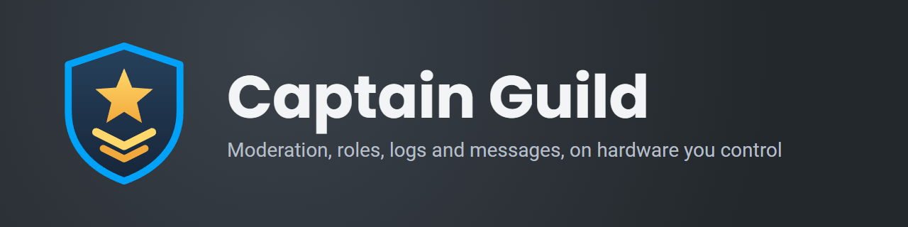

<p align="center">
  
</p>

<p align="center">
  <a href="https://github.com/hifihedgehog/CaptainGuild/actions/workflows/tests.yml"></a>
  <a href="LICENSE"></a>
  
  
</p>

Captain Guild is a self-hosted Discord bot with a web dashboard. One process runs moderation, automod, logging, reports, reaction roles, custom commands, posts, greetings, levels and voice controls, and its data sits in encrypted databases on your own machine.

## What it does

| Area | What's in it |
|---|---|
| Moderation | Bans, kicks, mutes, timeouts, warnings and notes, each a numbered case you can search, edit and export. Actions taken outside the bot become cases too. |
| Automod | Spam, links, invites, mentions, caps, bad words, unsafe files and honeypot channels, with a punishment per rule and a dry run to test a rule first. |
| Logging | Message, member, server and voice events in the channels you pick, naming who did it, with a search page for everything logged. |
| Reports | Members report a message or a person from the right-click menu. Staff get the evidence, the person's history and a checklist in one thread. |
| Reaction roles | Roles from reactions, buttons or menus, with limits, one-only groups, verify gates and timed roles. |
| Posts | An editor with live preview, a version history for each post with one-click revert, scheduled posting, and a tool that reposts messages another bot wrote so you can edit them. |
| Tags and triggers | Custom commands and automatic replies in a small template language with variables, math, conditions and embeds. |
| Voice | Temporary mutes and deafens, voice access requests with requirements, a trusted tier for short mutes with an optional vote, and roles held while in a channel. |
| Suggestions and proposals | Members suggest and vote, and staff decide. A bigger change goes to two votes on one post, one by members and one by moderators, with a discussion thread, and it passes only if both pass. |
| Community | Welcome and goodbye messages, birthdays, XP levels with rank cards and reward roles, starboard, sticky messages, highlights, reminders, giveaways and polls. |
| Alerts | Twitch streams, YouTube videos, free games, game deals, and scheduled feeds with role mentions. |

Each server sets all of this on its own dashboard, and a Quick setup page covers the common choices. The [docs page](captainguild/web/static/docs.html) lists every command and who can run it.

## Your data

Two [SQLCipher](https://github.com/sqlcipher/sqlcipher) databases hold everything, encrypted with AES-256 under keys derived from `MASTER_KEY`, which stays out of the databases and their copies. Message text is kept 30 days unless a server changes that. No data goes anywhere you didn't send it: the bot talks to Discord, and to an outside service only when someone uses a feature that needs one. [THIRD_PARTY.md](THIRD_PARTY.md) lists those services and what each receives.

A server's staff can download its whole setup and history as one file from the dashboard and put it back, and the bot keeps scheduled snapshots of each server. The [privacy page](captainguild/web/static/privacy.html) lists what's stored and for how long. Any member can type `/my_data` to see what the bot holds about them, download it, and delete what's theirs to delete.

## Host it yourself

You need Python 3.12 or newer and a reverse proxy with HTTPS. The pinned install from `requirements.lock` takes Python 3.13.

1. Create an application in the [Discord Developer Portal](https://discord.com/developers/applications). Turn on **Server Members Intent** and **Message Content Intent**, and leave Presence off. Turn off **Public Bot**, so only you can add it to a server.
2. Install it:
   ```sh
   git clone https://github.com/hifihedgehog/CaptainGuild.git
   cd CaptainGuild
   python -m venv venv && . venv/bin/activate
   pip install -r requirements.txt
   python -m captainguild.keygen
   cp .env.example .env
   chmod 600 .env
   ```
   Put the printed key in `.env` as `MASTER_KEY`, with your bot token as `DISCORD_TOKEN`. Back up the key on its own, away from the databases. They open only with this key.
3. Run it:
   ```sh
   python -m captainguild --public-url https://your.site --port 8893 --data data
   ```
   It creates the databases on the first run and listens on `127.0.0.1`. Its log has the link for adding the bot to your server. `captainguild.service` is a hardened systemd unit. To run it under pm2 with its packages kept apart from the machine's Python, install them on Python 3.13 with `pip install --target lib -r requirements.lock` and start `CaptainGuild.py`.
4. Point your proxy at that port.
5. Add the bot to your server and move its role above every role it hands out. Discord doesn't let a bot give or take a role at or above its own.
6. Type `/dashboard` in Discord. The bot answers with a private link that signs you in.

To sign in with Discord's own button instead of `/dashboard`, add `https://your.site/login/callback` as an OAuth2 redirect in the Developer Portal and put the application's client secret in `.env` as `DISCORD_CLIENT_SECRET`.

### Getting the data back

Everything comes back with `MASTER_KEY`, so keep a copy of it somewhere safe.

To copy a database while the bot runs:

```sh
python -m captainguild.dbtools copy main data/main.db backups/main.db
```

The first word after `copy` names the database, `main` or `messages`. The copy is encrypted under the same key.

To put a copy of the main database back, stop the bot, run this and start the bot. Role changes that came due since the copy was made don't run.

```sh
python -m captainguild.dbtools restore backups/main.db data/main.db
```

To put a copy of the messages database back, stop the bot, delete any `-wal` and `-shm` files beside it, copy the backup over it and start the bot.

To read the data in any SQLite tool, make a plain copy:

```sh
python -m captainguild.dbtools decrypt main backups/main.db readable.db
```

The new file isn't encrypted, so keep it private and delete it when you're done.

## Tests

`python scripts/run_tests.py` runs the suite, each test module in its own process and several at once. `python -m unittest discover -s tests -t .` runs it in one process. It drives every command, button, menu and form through the real discord.py library with only the network replaced, and fails on any logged error. `python scripts/demo_check.py shots cases reports` opens those dashboard pages in a browser on sample data, saves a picture of each in `shots` and reports browser errors. `python -m captainguild --demo` runs the same dashboard with no Discord connection, for trying pages out.

## License

MIT. See [LICENSE](LICENSE) and [THIRD_PARTY.md](THIRD_PARTY.md).
